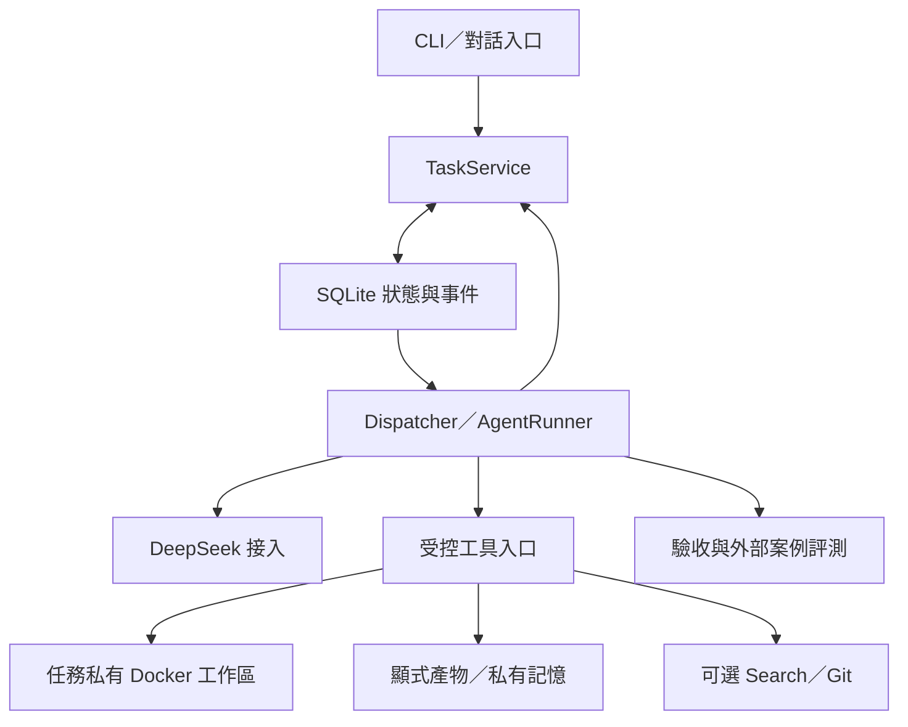

# 實作架構與 v0.3 的差異

日期：2026-10-19。交付類型：本地互動終端與批次 CLI。原始交付從 v0.3 設計建立程式；首次實測前的修正見 [PRE_LIVE_REVIEW.md](PRE_LIVE_REVIEW.md)，新增互動入口見 [TERMINAL.md](TERMINAL.md)。目前目錄沒有 Git 紀錄，未對外部署。

## 執行路徑

使用者請求建立一個 Workflow 和 root Task。TaskService 以 SQLite 交易同時寫入狀態與事件。路由先按能力篩選；指定負責人或只有一個候選人時直接分配，存在多個合法候選人時才進行一輪有帳本的 Bid。Bid 中的信心是 Agent 的自評，不構成權限。

Dispatcher 掃描 CREATED、READY、VERIFYING。READY 任務原子取得 Attempt；模型輸出先存入 snapshot，再執行工具。完整 assistant 內容、reasoning 與工具 ID 留在 snapshot；網頁工具在 snapshot 使用有來源 ID 的受控預覽，完整已接收結果保存在 operations。已記錄的呼叫不交給模型重新產生。

委派、詢問 Agent、詢問人類、工具審批共用 Wait。等待不佔住一個懸掛的模型請求；結果全部到齊後開新的 RESUME Attempt。子任務失敗、人工拒絕或等待逾時均可作為觀察結果交回父 Agent。REPLY 是有預算的葉節點，不能產生協作鏈。

最終結果必須是 `summary` 和 `artifact_ids`。驗收通過後才完成；失敗可以有限修復。程式類委派必須攜帶可執行的 unittest 驗收命令，不能只靠「已發布檔案」過關。任務內的驗收與外部案例評測是不同層次。

## 保留與改動

| v0.3 設計 | 本次實作 | 理由與代價 |
|---|---|---|
| Python + SQLite，單一任務狀態來源 | 保留；單程序排他鎖、短同步交易 | 避免並行 CLI 互相執行啟動恢復；未做多程序 worker |
| PydanticAI 單 Agent 層 | 改為小型原生 Python loop／Provider 邊界 | 直接掌握 DeepSeek reasoning 與工具配對的序列化；也必須自行維護及測試 loop |
| Deferred Tools 與 conversation | 改為顯式 snapshot、持久 Wait、RESUME | 不依賴未實測的 SDK 暫停介面；領域語義保持 |
| 每 Agent 工作區 | 改為每 workflow／task／owner 獨立工作區 | WAITING 釋放槽位後，同角色的別項任務不會改動暫停工作區 |
| 啟動時恢復 RUNNING | 同時讓 CREATED 與 VERIFYING 可被重新發現 | 修正路由或驗收中斷後永遠卡住的空窗 |
| 成功後才限制 effect_key | 執行前唯一預留，另記 call ID 別名 | 阻止相同副作用同時開始，以及別名改參數後再次執行 |
| root 只能交付自身產物 | 可以交付同工作流中明確授權的子任務產物 | planner 無需偽造所有權或複製檔案 |
| 任一終態可能觸發級聯的偽碼 | 失敗／取消／逾時才向下級聯 | 成功不誤殺子任務；仍有未結束後代時不能提前成功 |
| 可能多層重試 | Provider 無內部重試；Agent 呼叫由 TaskService 限制 | 不發生傳輸重試與任務重試倍增；Bid 傳輸錯誤目前終止路由 |
| FTS5／經驗 LLM 總結 | SQLite 子字串搜尋 + 按身份隔離的客觀終態經驗 | 能處理中文簡單包含查詢；沒有向量排序、Bid 校準或已證明的 Agent Evolution |
| 完整 UI | 可選 prompt_toolkit 互動終端、行式介面與批次 CLI | 會話、串流、父子任務樹及內嵌問答／審批；沒有獨立背景控制服務 |

## DeepSeek Harness 的參考方式

官方 Harness 的核心是 TypeScript／Node／Cordis 插件體系，Python SDK 控制的是子程序，不是原生 Python 引擎。這個專案沒有直接嵌入或 fork 整套 Harness，也沒有複製它的實作程式碼。

本次採用的設計參考是：模型、工具、循環和持久化分開；工具結果與呼叫成對；有結果則保留，結果未知則明確標示；取消後不盲目重放副作用。與官方不同，本版的 snapshot 是持久消息序列，events 是審計記錄，並未宣稱完整實作以 append-only events 重建全部模型上下文。

官方目前的原生 DeepSeek adapter 使用 Messages 協定。本版使用官方支援的 Chat Completions，因此沒有直接沿用其 Messages 序列化。工具請求下完整保留所有歷史 `reasoning_content`；不沿用舊範例在新使用者回合清空 reasoning 的規則。

## 恢復與副作用邊界

SQLite 交易涵蓋狀態、等待、訊息、審批和事件；遠端模型與 Git push 不在同一筆交易裡。模型請求中斷可能再次計費。工具操作先有 operation reservation，然後才外部執行。成功結果可以重用；RUNNING 操作在恢復時轉成 UNKNOWN，不直接重做。

未知 Git push 需要讀遠端 ref 核對。本版提供受控核對介面；UNKNOWN 不表示失敗，也不能宣稱 exactly-once。CLI 只支援單寫入者，舊 Attempt 會被 fencing；已啟動的外部效果不會因 fencing 自動撤銷。

## 隔離與權限

模型看不到 API key、Git 憑據或 Docker socket。Agent 不能指定發信者、記憶 owner、task ID 或 Attempt。工具每次重新讀取持久身份和權限；REPLY 的唯讀限制同時存在於 schema 與實際執行入口。

容器關閉網路、根檔案系統唯讀、丟棄 capabilities，以非 root 執行生成程式碼，設定記憶體、CPU、PID、輸出和逾時限制。固定 bootstrap 只負責具名卷根目錄的 owner／mode。檔案 helper 在容器內以目錄 fd 和 `O_NOFOLLOW` 讀寫普通 UTF-8 檔案，宿主不按 Agent 提供路徑讀工作區。

產物保存內容雜湊與 ACL。相同 Agent 身份的另一個 task 不會自動取得原 task 的未共享產物；授權共享仍限於相同 workflow。工具程式執行完畢會清掉容器，避免背景子程序延續；工作區具名卷保留以供恢復。

持久卷沒有可攜的硬磁碟配額；部署需另外配置磁碟限制與卷回收。Docker 的真實隔離效果取決於展示機 daemon、映像及 cgroup／rootless 配置，不能由離線測試推定。

## 目前邊界

這版以可信本地操作者為前提，不是多人線上服務。`human:local` 不是登入系統；不可直接對外開放。沒有 HKGAI 相容性聲明、自動上下文壓縮、向量記憶、跨主機恢復或正式教授測試集成績。

## 會話與呈現層

`SessionService` 在原資料表之外增加 `sessions` 與 `session_turns`。每輪仍是一個有獨立預算的 WORK workflow，執行器只恢復與調度選中會話的 workflow；其他會話的任務、等待和操作帳本不受影響。同一會話只能有一個未完成輪次。

根任務收到同會話的完整公開歷史，子任務收到委派內容及明確授權的產物。已公開的產物跨輪時校驗 hash、分配新 ID 並留下來源事件，沒有直接放寬跨 workflow 的存取權。任務深度、父子關係與取消範圍仍由 Store 決定，介面無權改寫。

串流只向呈現層送出內容 delta 與思考字數。provider 收齊 SSE、完成標記與工具參數後，才返回正常 Completion；Runtime 仍經原有操作帳本、驗證與完成流程。UI callback 出錯不改變任務結果，草稿也不提前寫成公開回答。

互動輪次的 `ExecutionMode` 與建立輪次在同一交易保存。即使執行器尚未啟動就中斷，示範工作也不能被真實模式誤恢復；問答與審批寫入前先核對模式。批次 `resume` 同樣拒絕未完成示範或模式不明的會話工作。

DeepSeek Search／Fetch 是獨立 HTTP 工具，由 researcher 的 schema、ToolGateway 身份授權和持久請求預算共同控制。模型 token 與網頁請求分開計數；外部內容保留來源並標記不可信。同一 workflow 的成功公開網頁證據可供各角色以 `read_web_result` 分頁讀取，失敗子任務已取得的證據仍可使用；私人訊息、reasoning 和一般產物不因此開放。成功的相同 provider／請求可重用既有 operation，新增 call binding 和重用事件；失敗、未知或執行中的操作不能命中快取。

模型請求把固定能力放在首段，變動的時間／預算／證據清單以暫時的尾端 system 訊息加入；該訊息不保存到 snapshot，也不建立 user turn。相同證據正文在同一請求中只保留第一份，其後留下工具配對及可重新讀取的 operation／offset。所有 assistant reasoning 維持原樣。`ModelRequestMeasured` 只保存角色／schema／reasoning 字元數，不保存內容或嘗試推算 token；真正用量以 API 回報為準，包含 cache hit／miss 和 reasoning 子計數。

每次模型請求附一份目前 UTC、實際可用角色工具、剩餘共享預算和公開網頁證據索引，不在 snapshot 重複堆疊。網頁觀察先投影為小型預覽；有上下文壓力時，較早的網頁預覽／讀取片段可換成可重新讀取的保存引用，原始操作紀錄不變，assistant／reasoning 與 tool ID 配對不刪除。這是確定性的資料投影，沒有模型生成的歷史摘要；仍超限就停止報錯。

最終 JSON 的格式修復與內容驗收分開。純格式修復列出既有授權產物 ID、禁用工具，也不提早重跑驗收命令；模式由持久化事件恢復。真正驗收失敗仍可使用工具修改。`COMPLETED` 表示執行生命週期已結束；會話和終端另附伺服器統計，不能以非空回答推定使用者目標已達成。

任務內 unittest 在任務工作區執行，並不是隔離的隱藏測試服務。本次真實協作另有固定外部案例在獨立 Docker 工作區驗證指定計數函式；它仍不能代替一般程式任務的正式評測集。
